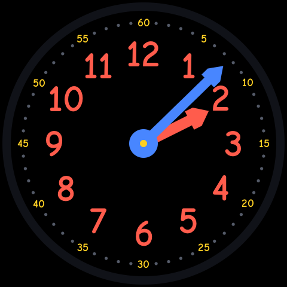
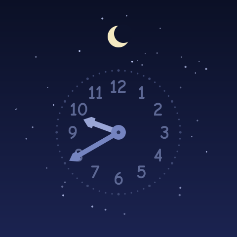
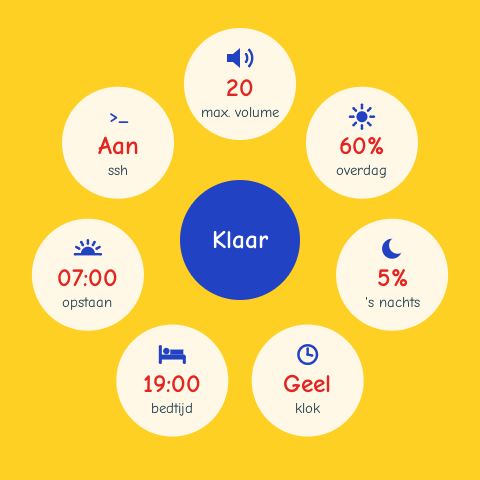
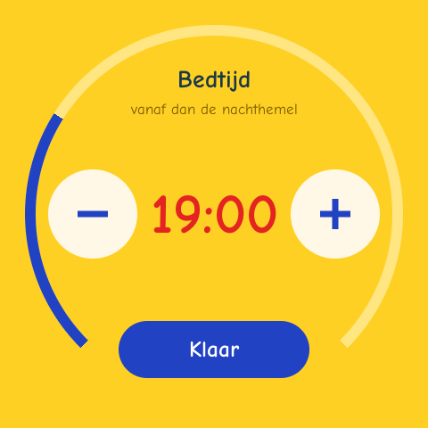

# TECHO5 Kids

**An Amazon Echo Spot (2017) turned into a learning clock for a child's room: a clock that tells the
time when you tap it, and has no microphones, no camera and no assistant at all.**

<p align="center">
  
  
  
  
  
</p>

This is a fork of [TECHO5](https://github.com/HuskerMinion/techo5), which frees old Echo devices from
Amazon and runs them on Alpine Linux as Home Assistant satellites. TECHO5 Kids keeps all of TECHO5's
groundwork (the unlock, the Linux image, the drivers for the screen, the touch panel, the buttons and the
speaker) and puts a different daemon on top: one made for a child's room.

## What it does

- **A learning clock**, after the yellow one from the classroom: big red hour numbers and a red hour hand,
  a ring of minute dots numbered every five up to 60 and a long blue minute hand. Also on black, like
  the Spot's bezel (*Kids Dark*), with the same three colors lifted to read on it.
- **Tap it and it tells the time**, in Dutch for now: *"Het is tien voor half acht."* The top button
  does the same. The device has no text-to-speech, so it plays one clip per minute, rendered beforehand.
- **Volume** from the buttons only (a swipe does nothing), never above the maximum a parent sets.
- **Night**: between bedtime and waketime the screen is a dim night sky with a small clock.
- **A parent menu**: hold both volume buttons for three seconds. Every setting is a large round button
  with an icon and its value (maximum volume, brightness by day and at night, the clock's look, bedtime,
  waketime, SSH) that opens on a page of its own with big − and + keys and a line saying what it does,
  in the shapes of TECHO5's own round screens and the clock's own colors. It closes by itself when it is
  left alone.

## What it does not have

TECHO5 is a voice satellite: microphones, wake words, a camera, calls, Home Assistant's assistant. In a
child's room none of that is wanted, so in TECHO5 Kids it is **not switched off, it is not there.** The
daemon is made of an explicit list of parts (`echod/internal/kids/all`), and the code that opens a
microphone or the camera is not in the binary at all. A test asks the Go toolchain what the binary is built
from and fails if anything that can listen or look is in it
([privacy_test.go](../echod/internal/kids/privacy_test.go)). The daemon comes out at 11 MB, against 33 MB for TECHO5's.

On the device itself the microphones' capture device is never opened, and nothing records. One
honest footnote: the speaker driver holds one unused capture node open without ever starting it. That
is a known workaround that keeps this kernel's playback buffer out of a memory path that crashes
(`hardware/speaker/paths_cronos.go`), and no sound flows through it.

## How the fork is built

Everything of TECHO5 Kids is in [`echod/internal/kids`](../echod/internal/kids) and
[`echod/cmd/kidsd`](../echod/cmd/kidsd). The rest of the repository is TECHO5 as it is upstream, merged
in as it moves on, so the hardware work there keeps arriving here.

| Package | What |
|---|---|
| `kids/core` | The clock's rules: settings, the night, the parent menu. No hardware; tests anywhere. |
| `kids/face` | What the screen shows. Draws into an image, so it previews on any machine: `KIDS_PREVIEW=/tmp/kids go test ./internal/kids/face` |
| `kids/clock` | The screen, touch panel, buttons and speaker put together. |
| `kids/all` | The parts the binary is made of, and so the parts it is not. |

## Trying it

It needs an Echo Spot (1st gen, `rook`) that already runs TECHO5 Spot: follow TECHO5's
[getting started](https://github.com/HuskerMinion/techo5/blob/main/docs/getting-started.md). Then:

```sh
cd echod
GOOS=linux GOARCH=arm GOARM=7 CGO_ENABLED=0 go build -tags spot -o kidsd ./cmd/kidsd
scp -O kidsd root@<spot>:/tmp/kidsd
ssh root@<spot> 'mount --bind /tmp/kidsd /usr/local/bin/techo5 && killall techo5'
```

That runs it until the next reboot, after which the Spot is back on TECHO5. Installing it for good
means copying it over `/usr/local/bin/techo5` in the running slot (keep the original beside it).
The spoken time needs a set of clips in `/data/misc/techo5/time/nl/`: `HHMM.wav` for every minute of a
twelve-hour clock (`0720.wav` is "Het is tien voor half acht."), 16-bit mono WAV at 16 kHz. A script to
render them is on its way.

Early days: this is one family's clock, being built in the open.

## Credit

[TECHO5](https://github.com/HuskerMinion/techo5) by HuskerMinion, built on
[EchoLocal](https://github.com/ygelfand/echolocal) by Yuri Gelfand, both MIT. TECHO5 Kids is MIT too:
[LICENSE](../LICENSE), [NOTICE](../NOTICE). TECHO5's own README is [here](../README.md).
